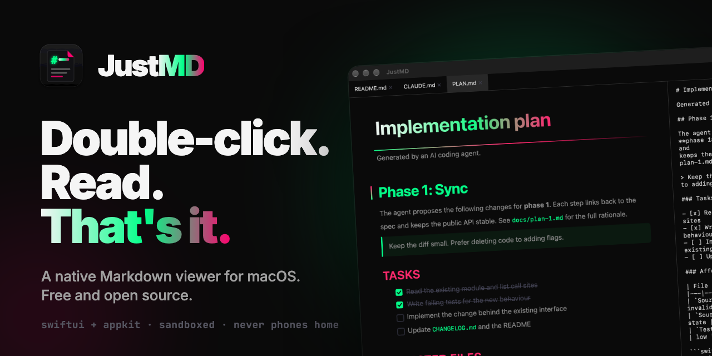
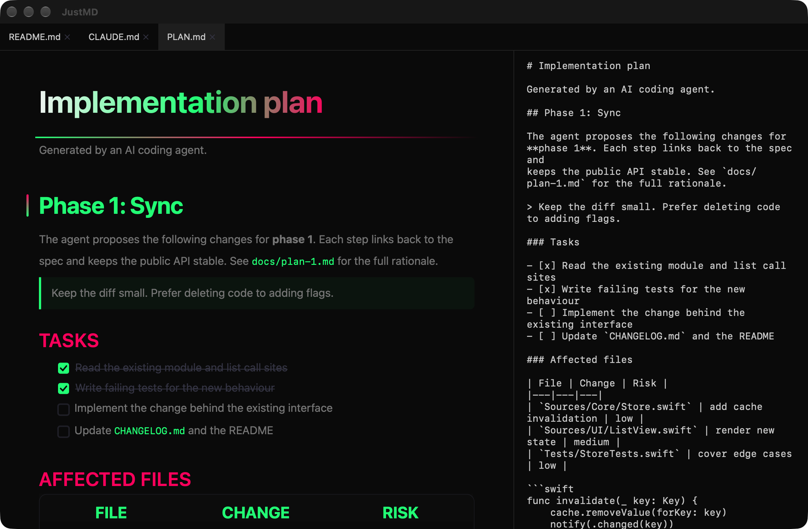
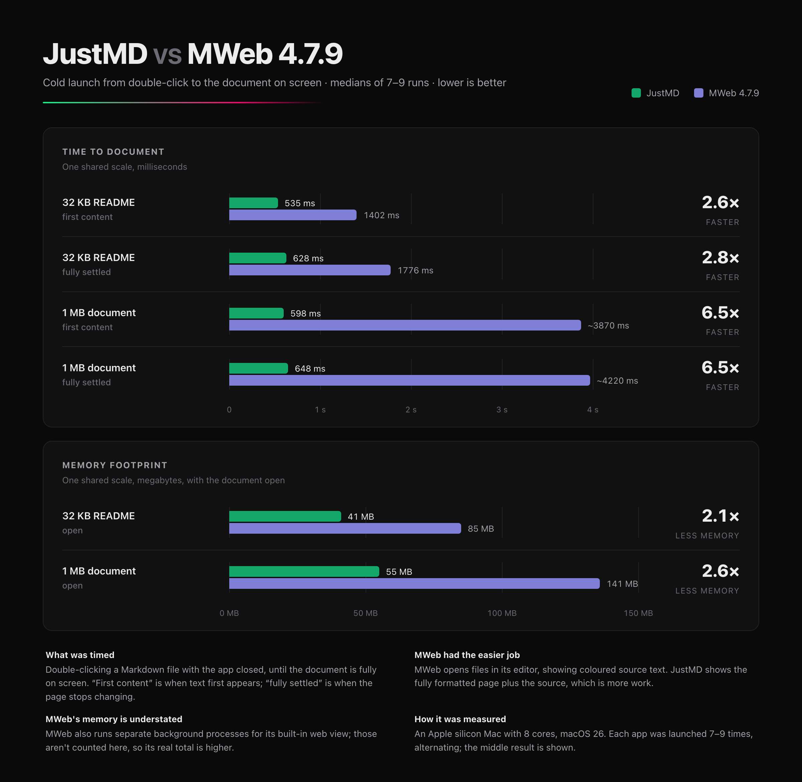

<p align="center">
  
</p>

<p align="center">
  <a href="#install"></a>
  <a href="https://github.com/kaanses/JustMD/releases/latest"></a>
  <a href="LICENSE"></a>
  
  
</p>

# JustMD

**A Markdown viewer that's actually a Mac app.** Double-click a `.md` file in Finder and it opens rendered, with the raw source beside it. No editor, no browser tab, no account.

Your coding agent writes Markdown all day: `README.md`, `CLAUDE.md`, plans, specs, changelogs. JustMD is for reading them. It opens a typical README in about half a second, and when your agent rewrites the file, the open tab reloads by itself.

<p align="center"><b><a href="https://github.com/kaanses/JustMD/releases/latest/download/JustMD.dmg">Download JustMD.dmg</a></b> · <a href="https://justmd.dev">justmd.dev</a> · Mac App Store: coming soon</p>

<picture>
  <source media="(prefers-color-scheme: dark)" srcset=".github/assets/screenshot-dark.png">
  <source media="(prefers-color-scheme: light)" srcset=".github/assets/screenshot-light.png">
  
</picture>

<sub>Neon on black at night, warm paper by day. It follows your Mac's appearance, and so does this screenshot.</sub>

## Fast, and measured

Against MWeb 4.7.9, the middle result of 7–9 cold launches per app on an Apple silicon Mac, Release build:

| | JustMD | MWeb | |
|---|---|---|---|
| 32 KB README, first content | **535 ms** | 1,402 ms | 2.6× faster |
| 1 MB document, first content | **598 ms** | ~3,870 ms | 6.5× faster |
| Memory, 32 KB README open | **41 MB** | 85 MB | about half |
| Memory, 1 MB document open | **55 MB** | 141 MB | about half |

MWeb opens files in its editor, while JustMD renders the full formatted page plus the source, so the comparison is harder for JustMD, not easier. Only MWeb was tested.

<p align="center"></p>

## What it does

- **Opens from Finder.** Double-click any `.md`, drag it onto the window, or press ⌘O. Your tabs come back on the next launch, and Open Recent keeps the rest.
- **Rendered and raw, side by side.** The source pane is read-only and hides with ⌥⌘S.
- **Reloads on save.** When your editor or agent rewrites a file, its tab updates in place, even through atomic saves.
- **Tabs** for every file you open, with ⌘1–⌘9 and ⌃Tab to move between them.
- **The Markdown you actually write:** tables with alignment, task lists, strikethrough, footnotes, links, images, inline HTML formatting, and fenced code highlighted for Swift, Python, JavaScript, TypeScript, JSON, shell and CSS.
- **Find** (⌘F), **zoom** (⌘+, ⌘−, ⌘0) and **print** (⌘P).
- **Two themes:** neon on black, and warm cream paper. It follows your system appearance.

## Private by design

JustMD never phones home. There are no analytics and no accounts. It's sandboxed and reads only the files you open; local images beside a document need you to grant that folder once. The network is used for images a document links to on the web and, in the direct download only, an update check you can turn down: the app asks before it ever checks. A check downloads one small file from GitHub, which sees your IP address and the app version like any web request. The App Store version never checks.

## Install

**Mac App Store:** coming soon, free.

**Direct download:** [JustMD.dmg](https://github.com/kaanses/JustMD/releases/latest/download/JustMD.dmg) (2.8 MB, notarized by Apple). Open it and drag JustMD to Applications. It can update itself if you allow it.

**Build from source** (macOS Tahoe 26.2+ and Xcode 26+):

```sh
git clone https://github.com/kaanses/JustMD.git && cd JustMD/JustMD && xcodebuild -scheme JustMD -configuration Release -derivedDataPath /tmp/justmd-build CODE_SIGN_IDENTITY=- DEVELOPMENT_TEAM= build && open /tmp/justmd-build/Build/Products/Release/JustMD.app
```

`CODE_SIGN_IDENTITY=- DEVELOPMENT_TEAM=` signs the app ad hoc so it builds without an Apple developer account.

### Make it your default for `.md`

Select any `.md` file in Finder, press ⌘I, choose JustMD under **Open with**, then click **Change All…**.

## How it works

JustMD is SwiftUI around AppKit text views. There is no web view.

- **Parsing:** Apple's [swift-markdown](https://github.com/swiftlang/swift-markdown) (cmark-gfm), walked into a styled `NSAttributedString`.
- **Rendering:** off the main thread, in parallel ~4 KB chunks split at headings, cached by content, so a reload only replaces the chunks that changed.
- **Drawing:** a custom TextKit 1 layout manager draws every decoration (the gradient H1, heading stripes, checkboxes, table borders, code block chrome) and only ever lays out what's on screen.

## Contributing

Bug reports with a sample `.md` file are the most useful thing you can send. Run the tests before opening a pull request:

```sh
cd JustMD && xcodebuild test -scheme JustMD -destination 'platform=macOS' CODE_SIGN_IDENTITY=- DEVELOPMENT_TEAM=
```

JustMD is a viewer on purpose. Editing features won't be merged; everything that makes reading better is welcome.

## License

[MIT](LICENSE)
